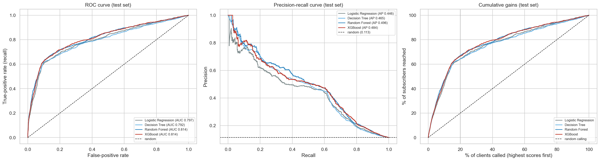
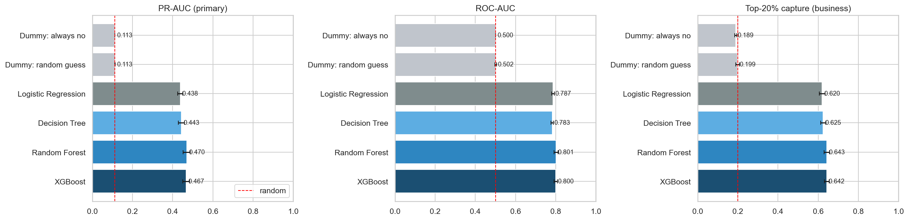
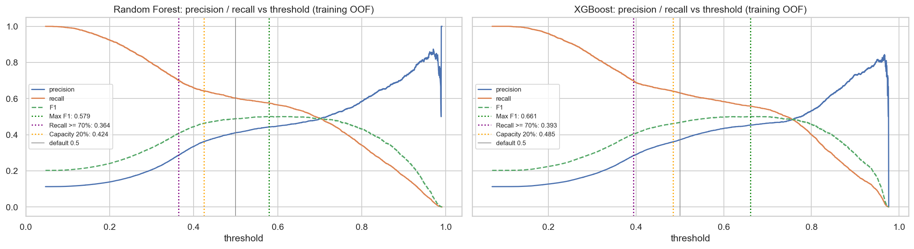
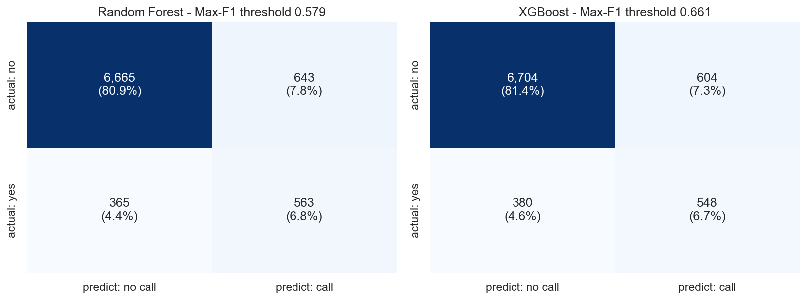
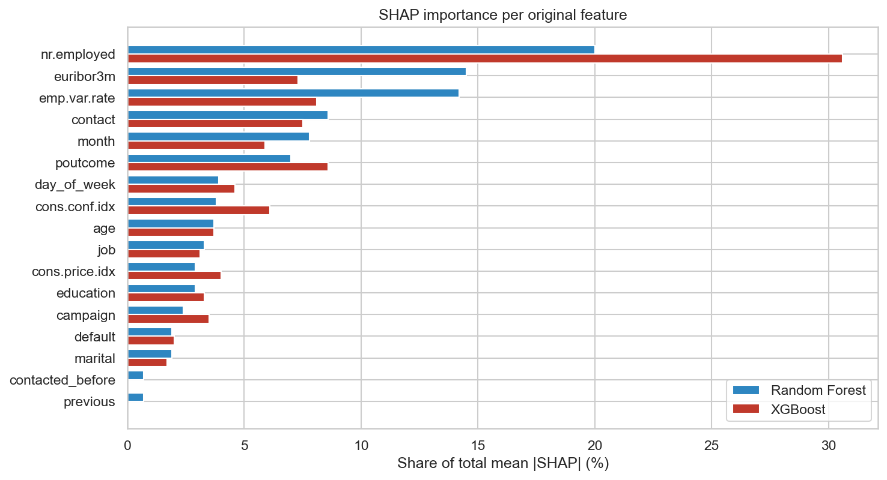
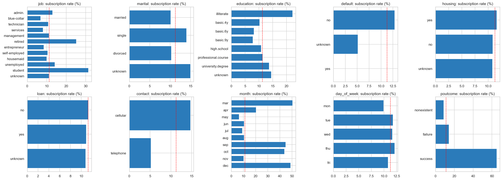
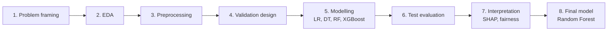

<div align="center">

# 🏦 Bank Marketing – Term-Deposit Campaign Response Prediction

**IT3091 Machine Learning · SLIIT · Group 2026-DS-02 · Lab group Y3.S1.WD.DS.0102 · Guided Data Track (Banking & Finance)**

[](https://www.python.org/downloads/)
[](https://scikit-learn.org/)
[](https://xgboost.readthedocs.io/)
[](https://shap.readthedocs.io/)
[](notebooks/2026-DS-02.ipynb)

[](https://colab.research.google.com/github/it24104110/Bank-Marketing-Campaign-Response-Prediction/blob/main/notebooks/2026-DS-02.ipynb)
[](https://nbviewer.org/github/it24104110/Bank-Marketing-Campaign-Response-Prediction/blob/main/notebooks/2026-DS-02.ipynb)
[](2026-DS-02_IT3091_Final_Report.pdf)
[](docs/model_card.md)
[](https://archive.ics.uci.edu/dataset/222/bank+marketing)

</div>

A bank calls thousands of clients to sell a term deposit, and only about 1 in 9 says yes. This project builds a model that
ranks clients by how likely they are to subscribe **before** they are called, so the call centre can phone the most promising
clients first and make far fewer wasted calls.

- 🎯 **Primary lens – Campaign Response Prediction:** supervised binary classification (target `y`), evaluated as a ranking problem.
- 🔍 **Secondary lens – Marketing Profile Analysis:** which client and campaign characteristics are linked to subscribing.

> [!TIP]
> **Headline result:** calling only the top 20% of the ranked list reaches **67% of subscribers** with **80% fewer calls**,
> and conversion rises from **11.3% → 37.7%**.

## 📑 Table of contents

- [📊 Key results](#-key-results)
- [🖼️ Figure gallery](#️-figure-gallery)
- [🔄 Workflow](#-workflow)
- [🗂️ Repository structure](#️-repository-structure)
- [⚙️ How to run](#️-how-to-run)
- [⚠️ Limitations and responsible use](#️-limitations-and-responsible-use)
- [👥 Team](#-team)
- [📚 Dataset and citation](#-dataset-and-citation)

---

## 📊 Key results

Hold-out test set: 8,236 clients, 928 of them subscribers (11.3%).

| Model | PR-AUC (primary) | ROC-AUC | Top-20% capture |
|---|---|---|---|
| Random guess | 0.116 | 0.51 | 20% |
| Logistic Regression (baseline) | 0.446 | 0.797 | 64.3% |
| Decision Tree | 0.465 | 0.792 | 64.2% |
| **🏆 Random Forest (final)** | **0.496** | **0.814** | **67.0%** |
| XGBoost | 0.484 | 0.814 | 66.5% |

**Final model:** Random Forest (300 trees, max depth 12, balanced class weights), trained **without** `duration` (leakage)
and without `age` / `marital` (data minimisation, with no loss in performance).

### 📞 Main operating rule: call the top 20% of the ranked list

| | Call everyone | Call top 20% |
|---|---|---|
| Calls | 8,236 | 1,651 (−80%) |
| Subscribers reached | 928 | 622 (67%) |
| Conversion rate | 11.3% | **37.7% (3.3×)** |
| Wasted calls | 7,308 | 1,029 |

Alternative rule (Max F1, score ≥ 0.638): 1,125 calls → 536 subscribers, 47.6% conversion.

<details>
<summary><b>📋 Full test-set metrics (threshold 0.5)</b></summary>

| Model | PR-AUC | ROC-AUC | Precision | Recall | F1 | Balanced acc. | Accuracy |
|---|---|---|---|---|---|---|---|
| Dummy: always no | 0.113 | 0.500 | 0.000 | 0.000 | 0.000 | 0.500 | 0.887 |
| Dummy: random guess | 0.116 | 0.512 | 0.135 | 0.133 | 0.134 | 0.512 | 0.807 |
| Logistic Regression | 0.446 | 0.797 | 0.338 | 0.662 | 0.448 | 0.749 | 0.816 |
| Decision Tree | 0.465 | 0.792 | 0.303 | 0.680 | 0.420 | 0.741 | 0.788 |
| Random Forest | 0.496 | 0.814 | 0.431 | 0.637 | 0.514 | 0.765 | 0.864 |
| XGBoost | 0.484 | 0.814 | 0.390 | 0.656 | 0.490 | 0.763 | 0.846 |

Accuracy is misleading here: always predicting "no" already gives 88.7%. That is why PR-AUC and top-20% capture are the main metrics.

</details>

<details>
<summary><b>🔁 Cross-validation results (training set, stratified 5-fold, mean ± std)</b></summary>

| Model | PR-AUC | ROC-AUC | F1 | Top-20% capture | Folds better than baseline |
|---|---|---|---|---|---|
| Logistic Regression | 0.438 ± 0.012 | 0.787 | 0.432 | 0.620 | – |
| Decision Tree | 0.443 ± 0.016 | 0.783 | 0.425 | 0.625 | 3/5 |
| Random Forest | **0.470 ± 0.018** | **0.801** | **0.489** | **0.643** | **5/5** |
| XGBoost | 0.467 ± 0.017 | 0.800 | 0.468 | 0.642 | **5/5** |

Class weights beat SMOTE for every model, so SMOTE was not used.

</details>

<details>
<summary><b>🔧 Best hyperparameters</b></summary>

| Model | Search | Best setting |
|---|---|---|
| Logistic Regression | Grid, 6 | `C = 0.01`, class_weight = balanced |
| Decision Tree | Grid, 80 | entropy, max_depth = None, min_samples_leaf = 100, balanced |
| Random Forest | Random, 20 | 300 trees, max_depth = 12, min_samples_leaf = 10, max_features = 0.3, balanced |
| XGBoost | Random, 25 | 600 rounds, learning_rate = 0.01, max_depth = 5, min_child_weight = 5, subsample = 0.7, scale_pos_weight = 7.88 |

</details>

---

## 🖼️ Figure gallery

<table>
  <tr>
    <td align="center"><br><sub>ROC, PR and gains curves (test set)</sub></td>
    <td align="center"><br><sub>Model comparison (5-fold CV)</sub></td>
  </tr>
  <tr>
    <td align="center"><br><sub>Threshold trade-off</sub></td>
    <td align="center"><br><sub>Confusion matrices</sub></td>
  </tr>
  <tr>
    <td align="center"><br><sub>SHAP importance by feature</sub></td>
    <td align="center"><br><sub>Subscription rate by category (EDA)</sub></td>
  </tr>
</table>

All figures (fig00–fig21) are in [`figures/`](figures/).

---

## 🔄 Workflow



<details>
<summary><b>What happens in each stage</b></summary>

1. **Problem framing:** business goal, target, success metric (PR-AUC, top-20% capture).
2. **EDA:** data dictionary, class imbalance, subscription rates by feature, correlations, time patterns.
3. **Preprocessing:** remove duplicates, drop `duration` (only known after the call), cap `campaign`, replace `pdays` with `contacted_before`, stratified 80/20 split.
4. **Validation design:** stratified 5-fold CV (same folds for every model), leakage benchmark, time-drift check.
5. **Modelling:** 4 tuned models, with class weights compared against SMOTE (class weights won for every model).
6. **Evaluation:** test-set metrics, bootstrap confidence intervals, threshold trade-off, per-year robustness.
7. **Interpretation:** permutation importance, SHAP, marketing segments, fairness by age and marital status.
8. **Final model:** refit on all data, operating rules, model card, recommendations.

</details>

---

## 🗂️ Repository structure

<details>
<summary><b>Show folder tree</b></summary>

```
├── data/
│   ├── raw/                 bank-additional-full.csv + UCI documentation
│   └── processed/           bank_clean.csv, train.csv, test.csv
├── notebooks/
│   ├── 2026-DS-02.ipynb                 <- final merged notebook (submission)
│   ├── 00_setup_and_data_loading.ipynb  dataset fingerprint check
│   ├── 01_eda.ipynb                     data dictionary, EDA
│   ├── 02_preprocessing.ipynb           cleaning, split, feature selection, pipelines
│   ├── 03_validation.ipynb              CV design, metrics, leakage benchmark, time drift
│   ├── 04_modelling.ipynb               4 tuned models, comparison, SMOTE check
│   ├── 05_evaluation.ipynb              test set, bootstrap CIs, thresholds, per-year
│   ├── 06_interpretation.ipynb          SHAP, importance, segments, fairness
│   └── 07_final_model.ipynb             final model, operating rules, demo
├── src/
│   ├── config.py            shared paths, seed, feature groups
│   ├── preprocessing.py     shared cleaning / pipeline code
│   ├── evaluation.py        shared metrics and plots
│   └── build_final_notebook.py
├── models/                  4 tuned models + final_model.joblib
├── results/                 result tables (CSV / JSON)
├── figures/                 all report figures (fig00–fig21)
├── docs/                    decision log, model card, write-ups
├── 2026-DS-02_IT3091_Final_Report.pdf
└── requirements.txt
```

</details>

<details>
<summary><b>📝 Documentation in <code>docs/</code></b></summary>

| Topic | File |
|---|---|
| Problem framing canvas | [`problem_framing_canvas.md`](docs/problem_framing_canvas.md) |
| Decision log | [`decision_log.md`](docs/decision_log.md) |
| Data dictionary | [`data_dictionary.csv`](docs/data_dictionary.csv) |
| EDA insights | [`eda_insight_log.md`](docs/eda_insight_log.md), [`eda_findings.txt`](docs/eda_findings.txt) |
| Preprocessing / features | [`preprocessing_log.md`](docs/preprocessing_log.md), [`preprocessing_findings.txt`](docs/preprocessing_findings.txt) |
| Validation | [`validation_findings.txt`](docs/validation_findings.txt) |
| Model comparison | [`model_comparison.md`](docs/model_comparison.md), [`modelling_findings.txt`](docs/modelling_findings.txt), [`evaluation_findings.txt`](docs/evaluation_findings.txt) |
| Marketing profiles (secondary lens) | [`marketing_profiles.md`](docs/marketing_profiles.md), [`interpretation_findings.txt`](docs/interpretation_findings.txt) |
| Model card | [`model_card.md`](docs/model_card.md) |
| Recommendations and limitations | [`recommendations.md`](docs/recommendations.md) |
| Dataset fingerprint | [`dataset_fingerprint.md`](docs/dataset_fingerprint.md) |
| AI-use declaration | [`ai_use_declaration.md`](docs/ai_use_declaration.md) |

</details>

---

## ⚙️ How to run

Tested with **Python 3.13.7** (scikit-learn 1.7.1, pandas 2.3.2, xgboost 3.2.0, shap 0.52.0).

```bash
git clone https://github.com/it24104110/Bank-Marketing-Campaign-Response-Prediction.git
cd Bank-Marketing-Campaign-Response-Prediction
pip install -r requirements.txt
jupyter notebook
```

Open [`notebooks/2026-DS-02.ipynb`](notebooks/2026-DS-02.ipynb) and choose **Kernel → Restart & Run All**, or run the stage notebooks
`00` → `07` in order. The notebooks check the dataset's SHA-256 hash at the start, and every step uses `random_state = 42`.

> [!NOTE]
> A full run takes about **50–60 minutes**, mostly for hyperparameter tuning.

> [!WARNING]
> **Windows:** hyperparameter searches run their folds one after another, because process-based parallelism
> (`n_jobs=-1` in `GridSearchCV`) crashes with joblib 1.5.1 on Windows / Python 3.13. Thread-based `n_jobs` is still used inside the models.

> [!IMPORTANT]
> **Google Colab:** the notebook reads files from `data/` and `src/`, so clone the repo first in a Colab cell
> (`!git clone https://github.com/it24104110/Bank-Marketing-Campaign-Response-Prediction.git` then `%cd Bank-Marketing-Campaign-Response-Prediction`). Colab's Python version may differ from 3.13.

<details>
<summary><b>🐍 Using the saved model</b></summary>

```python
import joblib
import pandas as pd

model = joblib.load("models/final_model.joblib")
clients = pd.read_csv("data/processed/test.csv")
scores = model.predict_proba(clients)[:, 1]   # higher score = call earlier
```

The scores are for **ranking** clients. They are not calibrated probabilities, because class weights push them upwards.

</details>

---

## ⚠️ Limitations and responsible use

- 📉 **Time drift:** performance depends on economic conditions. Training on the past and testing on the future gave ROC-AUC ≈ 0.55. Retrain before each campaign.
- 🌍 The data comes from one Portuguese bank during 2008–2010 (the financial crisis).
- 📈 About 55% of the model's importance comes from economic indicators, which describe *when* a campaign runs rather than *who* the client is.
- ⚖️ Clients aged 61+ are selected far more often. This matches their real response rates, but because proxies like `job = retired` remain,
  selection should be monitored by group.

> [!CAUTION]
> This model is for **call prioritisation only**. It must not be used for credit or eligibility decisions, and a person should review every call list.

See [`docs/model_card.md`](docs/model_card.md) for the full details.

---

## 👥 Team

| Member | Student No | Model | Main stage |
|---|---|---|---|
| Karunathilaka S.H.T.R | IT24103860 | Logistic Regression (baseline) | Problem framing, EDA |
| Jayasuriya J.A.Y.N | IT24104178 | Decision Tree | Preprocessing, responsible-AI check |
| Thulmanthi W.A.S | IT24104110 | 🏆 Random Forest (final) | Interpretation, final model, notebook integration |
| Thennakoon T.M.S.D | IT24103869 | XGBoost | Validation, evaluation, recommendations |

---

## 📚 Dataset and citation

UCI Machine Learning Repository: [Bank Marketing](https://archive.ics.uci.edu/dataset/222/bank+marketing),
`bank-additional-full.csv` (41,188 rows × 21 columns, May 2008 – Nov 2010).
SHA-256 `74adfc578bf77a7ff4bb1ba4a9f8709d9e3c6907342959c2c8416847e0afb4d8`.

> Moro, S., Cortez, P., & Rita, P. (2014). A data-driven approach to predict the success of bank telemarketing.
> *Decision Support Systems*, 62, 22–31. https://doi.org/10.1016/j.dss.2014.03.001

The dataset is licensed under [CC BY 4.0](https://creativecommons.org/licenses/by/4.0/).
This repository was produced as academic coursework for IT3091 at SLIIT.

<div align="center">

⭐ *If you found this project useful, consider giving it a star!*

</div>
